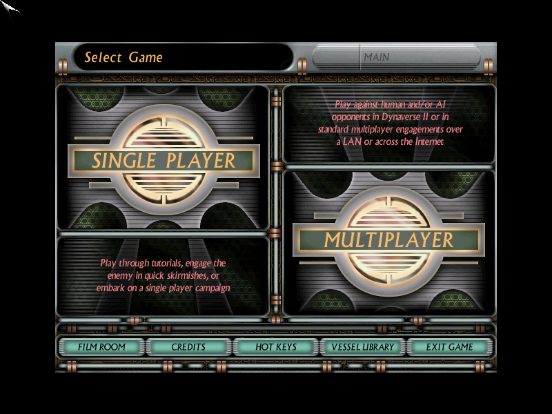
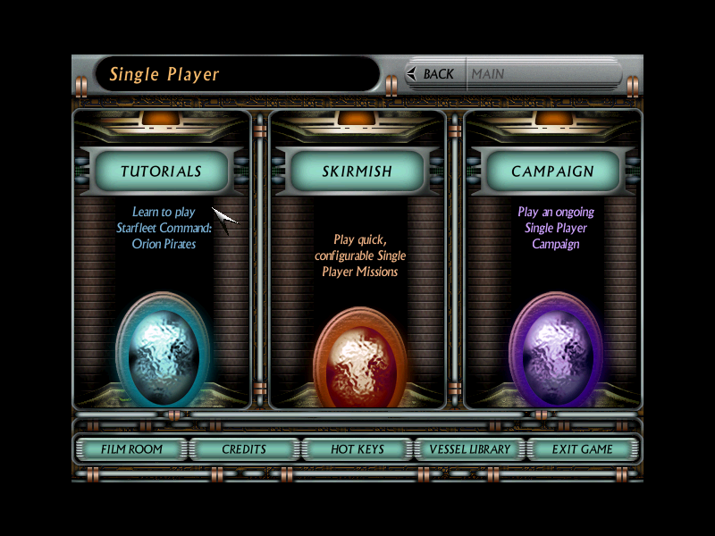
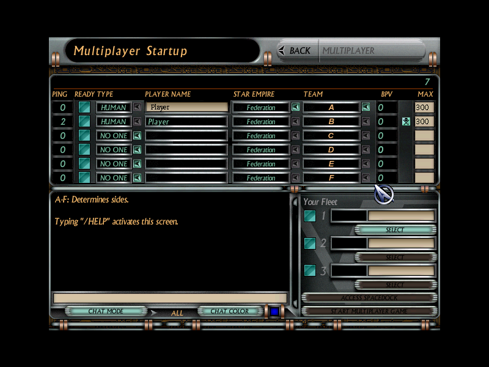
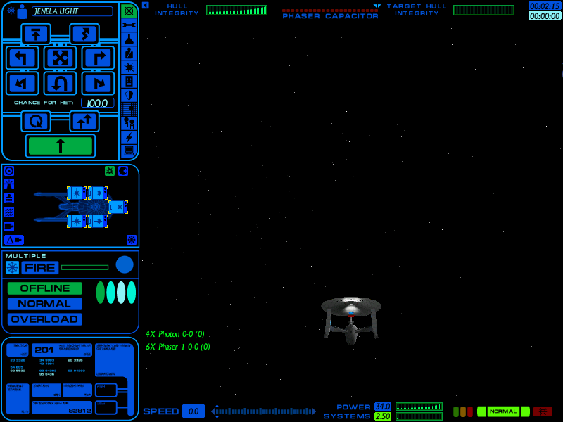

# SFCOP-port

The native port of **Star Trek: Starfleet Command II — Orion Pirates**
(version 2.5.5.2) for Apple Silicon Macs, Windows and Linux, verified against the original game.

No game file ships with this project. You bring your own retail install; the port reads it in
place, unchanged.



## What it is

Orion Pirates was released in 2001 for Windows and depends on layers that no longer exist: DirectX 6
interfaces, DirectPlay 4 for multiplayer, and online services for the Dynaverse campaigns that were
switched off years ago. This project rebuilds the game as readable C++ and gives it a platform
layer of its own, so the whole game runs again on current machines and its online parts run against
servers the project hosts.

- `decomp/` is the decompilation, the original game's code recovered function by function in its
  own repository (SFC2-decomp) and pinned here as a git submodule. Every function there is checked
  byte for byte against the original binary; here a replay oracle compares the native build's
  per-tick simulation trace with the original's.
- `src/` is the platform layer: DirectDraw, Direct3D, DirectInput, DirectPlay, Winsock, the
  registry and the sound library replaced over SDL3, the SDL GPU API, miniaudio and sockets, plus
  the fixes to the game's own bugs, each behind a switch whose default is the original behaviour.
- `server/` holds the services the online game needs: a lobby and relay for internet play between
  native clients, and the directory and authentication services the Dynaverse client logs on to.
- `oracle/` and `tools/` are the verification machinery: the replay oracle and the lifter that runs
  the original's code natively until it is decompiled.

Until a function is decompiled, the lifter translates it from the original executable at build
time, so the native client has run the complete game from the first day while the decompiled
share grows.

## What works today

| | |
| --- | --- |
|  |  |
| Skirmish and the single-player campaigns, from the menu to combat | Multiplayer over a LAN: two native clients host and join through the game's own screens |

- The client boots to the main menu, loads the mission scripts and plays skirmishes and campaigns.
  Saves, settings and campaign files are written in the formats the original reads.
- Two native clients on one network host and join a multiplayer game.
- The Dynaverse screens reach the login: the version check, account creation and logon complete
  against this project's own directory and authentication services. The campaign server behind
  them is the next step.
- A one-command build produces a double-clickable `SFCOP.app` on macOS. Windows and Linux build
  in CI and lag in features until macOS is complete.
- Two headless runs of the oracle skirmish produce the same trace, which is what every later change
  is measured against.



## Installing a release

Releases are on the repository's Releases page. Each package is the native client, ready to run:
its game code is translated from the original executable when the release is built. It carries
no file of the original game, and it plays from your own Orion Pirates install, patched to
2.5.5.2 (it can stay where it is, on any disk; the client only reads it).

| Your machine | Download |
| --- | --- |
| Mac with Apple silicon, macOS 11 or later | `SFCOP-<version>-macos-arm64.dmg` |
| Linux x86-64 (glibc 2.31 or later: SteamOS 3, Ubuntu 20.04 and later) | `SFCOP-<version>-linux-x64.tar.gz`, or the `.AppImage` |
| Linux arm64 (glibc 2.36 or later: Debian 12, Ubuntu 22.10 and later) | `SFCOP-<version>-linux-arm64.tar.gz`, or the `.AppImage` |
| Windows 10 or 11, x64 | `SFCOP-<version>-windows-x64.zip` |
| Windows 11 on Arm | `SFCOP-<version>-windows-arm64.zip` |

A release lists what it carries in its notes. The Windows packages have been exercised under
Wine on the build machine, not yet on a Windows PC; say what you see.

**macOS.** Open the `.dmg` and drag `SFCOP.app` onto Applications. The app is not signed, so
macOS refuses it the first time: open System Settings > Privacy & Security and choose Open
Anyway next to SFCOP (on macOS 14 and older, right-click the app, choose Open, then Open again).
If your install
is on an external disk, macOS asks once whether SFCOP may read removable volumes; allow it, or the
client cannot read the install. A double-click cannot ask where the install is: started from
Finder before it knows one, the client stops and writes why to `logs/launch-<stamp>.log` (everything) in the data folder, and a line saying it ended to
`logs/important-<stamp>.log` (the start line, refused script loads, faults, the exit; `platform/Core/Log.h`). So start it once from Terminal with the path:

```bash
/Applications/SFCOP.app/Contents/MacOS/sfcop-launch --install "/path/to/Starfleet Command Orion Pirates"
```

**Linux.** Unpack the archive and run `./sfcop --install "/path/to/Starfleet Command Orion Pirates"`
from its folder, or `chmod +x` the AppImage and run it with the same argument.

**Windows.** Unzip the folder anywhere and run `sfcop.exe --install "C:\path\to\Starfleet Command Orion Pirates"`
from a command prompt in it; an install under Program Files is found without the argument. The
program is not signed, so SmartScreen may warn ("More info", then "Run anyway").

On the first run the client checks every file of the install against the known hashes, names
any file that differs (reinstall and re-patch to 2.5.5.2 if one does), and remembers the path;
later runs need no argument. Then the game asks for its CD key as the original does. Settings,
saves and logs live in the per-user data folder (`~/Library/Application Support/SFCOP`,
`~/.local/share/SFCOP`, `%APPDATA%\SFCOP`). On macOS, while the game runs, File > Show Game Files
in Finder opens that folder and File > Show Logs in Finder its logs. Deleting the folder (with the
game closed) starts over as a fresh install: any imported copy, the remembered install path,
settings, saves and logs (unless `--logs` put them elsewhere) all go with it.

**Missions** need translated mission modules, which no release carries, because they are made
from your install's own mission scripts. Without them the menus run and the missions are missing.
In this alpha they are made with the build tools: with a checkout of this repository, Docker and
the lifter's pcrecomp clone (`cmake/lifter/setup.sh`), run on the machine that plays

```bash
python3 tools/scr2native/scr2native.py --all "/path/to/Starfleet Command Orion Pirates" -o "<data folder>/mods/missions"
```

where `<data folder>` is the folder above; the client looks there by default
(`tools/scr2native/README.md`). This has been run on macOS; a module is built for the machine
that runs the tool.

## Building and running

Clone with `git clone --recurse-submodules` (or run `git submodule update --init` in a clone).
Requirements: a retail Orion Pirates install patched to 2.5.5.2, CMake and Ninja, a C++17
compiler, Python 3, and Docker for the lifter's toolchain.

```bash
cmake --preset macos-arm64 -DSFCOP_INSTALL_DIR="<path to your install>"
cmake --build build/macos-arm64 -j4
build/macos-arm64/sfcop --windowed
```

One command builds a platform's client with the lift and writes it, and its release package,
to `dist/` (`packaging/README.md`):

```bash
sh scripts/dist.sh macos-arm64      # dist/SFCOP.app and the .dmg
sh scripts/dist.sh linux-x64        # dist/SFCOP-<version>-linux-x64/, the .tar.gz and the AppImage
sh scripts/dist.sh windows-x64      # dist/SFCOP-<version>-windows-x64/ and the .zip
```

`linux-arm64` and `windows-arm64` work the same way. The Linux and Windows presets cross-compile
on the Mac with the toolchains `sh cmake/toolchains/setup.sh` installs
(`cmake/toolchains/README.md`). On first start the client looks for the install in the usual
places, asks if it cannot find it, and verifies every file it reads against the known hashes. Its
settings and saves live in the per-user data folder; the retail install is never written to.

`sh scripts/check.sh` is the definition of done: the Python tests, the override table against the
pinned decompilation, the C++ tests and the replay oracle. CI runs it on the Mac; pull requests
build macOS only while the Linux and Windows presets are paused (`oracle/presets/ci.py`). Releases are made by
`.github/workflows/release.yml` on a `v*` tag or by hand, as a draft the owner publishes.

## How the work is organized

`AGENTS.md` is the contract for everyone and everything that commits here, `docs/DESIGN.md`
defines the behaviour, `docs/CONVENTIONS.md` the code, and `docs/PLAN.md` the work packages.
The decompilation's own rules and progress report are in `decomp/` (SFC2-decomp).

## Progress

The decompilation's progress, per game, is tracked in SFC2-decomp's README. A function enters this
build once it is byte-exact there and the pin here has moved past it (a bump pull request).

## Status and legal

The project is under active development. It contains no retail executable, library or asset,
nothing derived from one byte for byte, and no third-party code outside `third_party/`. Star Trek and
Starfleet Command are trademarks of their respective owners; this is an unaffiliated preservation
project.

SFCOP is free software: you can redistribute it and/or modify it under the terms of the GNU General
Public License as published by the Free Software Foundation, either version 3 of the License, or
(at your option) any later version. It is distributed in the hope that it will be useful, but
WITHOUT ANY WARRANTY; without even the implied warranty of MERCHANTABILITY or FITNESS FOR A
PARTICULAR PURPOSE. See `LICENSE` for the full text. The code under `third_party/` keeps its own
licence, listed in `third_party/INVENTORY.md`; each is compatible with the GPL. The decompilation
under `decomp/` is its own repository, SFC2-decomp, under its own terms.

The licence covers this repository's own source. It does not cover the game: a release package
also carries game code translated from the original executable when the package is built, and the
client reads your own copy of the game's files. Neither is offered under the GPL.
