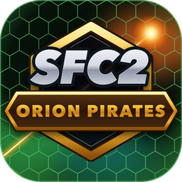

# The application icon

A gold hexagon badge with "SFC2" and an "ORION PIRATES" band over a green hex grid, drawn from
code in `draw_icon.py`. It contains no image, logo or lettering from the original game.



| File | Use |
| --- | --- |
| `packaging/macos/SFCOP.icns` | The `.app` icon (`CFBundleIconFile` is `SFCOP`). Holds 16 to 1024 px |
| `packaging/windows/SFCOP.ico` | The `.exe` icon, 16 to 256 px. Not linked into `sfcop.exe` yet: that needs a resource script added to the `sfcop` target |
| Linux | `packaging/linux/write_icon.py` takes the 512 px entry of `SFCOP.icns` for the desktop entry and the AppImage |

To change it, edit `draw_icon.py`, then on macOS:

```sh
python3 packaging/icon/draw_icon.py "$OUT/icon.html"
"/Applications/Google Chrome.app/Contents/MacOS/Google Chrome" --headless=new --hide-scrollbars \
  --default-background-color=00000000 --window-size=1024,1024 \
  --screenshot="$OUT/icon-1024.png" "file://$OUT/icon.html"
python3 packaging/icon/package_icon.py "$OUT/icon-1024.png" "$OUT" SFCOP sfcop
cp "$OUT/macos/SFCOP.icns" packaging/macos/ && cp "$OUT/windows/SFCOP.ico" packaging/windows/
```

`$OUT` is a work folder outside the repository. The page needs the Avenir Next font.
