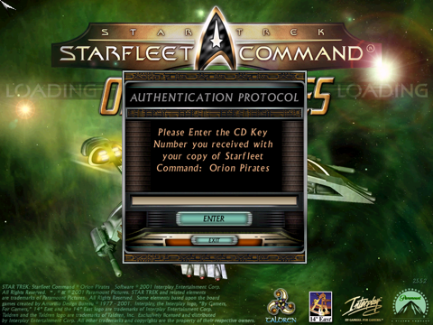

# P1-2 win32hle gaps: report

Date: 2026-11-03. Target: `StarFleetOP.exe` 2.5.5.2, lifted by the P0-4 spike (pcrecomp `ef3f0da`).
Host: arm64 macOS, Apple clang, SDL2. All numbers come from `scripts/run_all.sh`, and its outputs
are in `results/`. How to rerun: `README.md`.

## Verdict

**The lifted game boots natively to the CD-key prompt and stays up.** It runs at the prompt
without a fault until the 60 s watchdog stops it, in each of the three recorded runs
(`results/run_headless.txt`, `results/run_headless_untraced.txt`, `results/run_window.txt`).
The P0-4 spike stopped at the first missing import, `DirectInputCreateA`, 0.6 s after WinMain.

**The P1-2 acceptance line, the main menu, is not met.** The menu is behind the CD-key dialog,
and getting past it needs a key: either the game's stored key supplied to the run without ever
being printed, through an `oracle/` script, or typed input reaching the dialog, which has not
been traced yet.

In order, from the windowed run's log and screenshots (`results/run_window.txt`):

| When | What happens |
|---|---|
| 0.2 s | WinMain (`[mark]`): window class and window |
| then | DirectDraw: a 640x480 primary, then `SetDisplayMode(800x600x16)` with a flip chain; a D3D device with a z-buffer |
| then | DirectInput keyboard: `CreateDevice(GUID_SysKeyboard)`, `SetDataFormat`, `SetCooperativeLevel`, `Acquire` |
| then | Miles: the digital driver opens (silent) with 16 sample handles |
| 5 s shot | The loading screen; game data is read from `gameroot` |
| 10 s shot onward | The "Authentication Protocol" CD-key dialog, idle in the game's frame loop until the watchdog. Every later shot is identical |

`results/cdkey_prompt.png` is the frame shown 10 s into the windowed run, downscaled to 480x360.
It shows the "Authentication Protocol" dialog over the loading screen, with the key field empty;
nothing was typed. The full-resolution series is not committed. Each `window` run writes it to
`$SFCOP_ROOT/work/lifter-hle/shots/window/`.

The boot never reaches a guest C++ throw, an unresolved indirect call or an unimplemented import.
All 75 imports that the spike found win32hle lacks are now answered
(`results/imports_previously_missing.tsv`). Every import the boot calls is answered.

## Frame rate

At the CD-key prompt (`results/run_window.txt`, `results/run_headless_import_counts.txt`):

- **Shown:** 66 to 68 frames per second (67 in 43 of 59 seconds) in a window (Cocoa, Metal renderer). win32hle's presenter
  paces presentation to the display; the game's loop does not wait for it.
- **Game loop:** about 1,150 frames per second, headless, with every import traced to stderr. In
  60 s the game made 65,902 BeginScene/EndScene/Flip/Clear2/PeekMessageA rounds, and 199,928
  surface Lock/Unlock pairs. The windowed run counts 1,200 to 1,400 primary-surface updates per
  second.

The game does not limit its own frame rate on this path, so the menu's speed is bounded by the
software rasteriser and the presenter, not by the game. The P1-1 renderer work should add a frame
cap or vsync. 1,000 frames a second at the prompt only heats the laptop.

## What was added

Module by module (file list and upstream marking: `README.md`):

1. **DirectInput keyboard** (`src/dinput.c`). DirectInput 7 interfaces on SDL2's keyboard
   state, mapped to DIK scan codes. Immediate (`GetDeviceState`) and buffered (`GetDeviceData`,
   from the difference to the last state reported) data. The keyboard GUID was checked against the
   exe's bytes. A mouse or joystick is refused with `DIERR_DEVICENOTREG`; the game reads the mouse
   through `GetCursorPos`.
2. **Miles samples** (`src/mss_sample.c`). The 22 AIL_* sample calls (plus the redist fix below), with real playback on an
   SDL2 audio device: PCM and IMA ADPCM, double buffering, the done/playing/stopped states the
   streamer polls. `--silent` (and every headless run) keeps the timing with no output. The self
   test checks the ADPCM decoder against a hand-decoded block and the buffer cycle under a manual
   clock.
3. **DS3D** (`src/ds3d.c`). The 3D buffer and listener interfaces from
   `IDirectSoundBuffer::QueryInterface`, IIDs checked against the exe. Values are stored and
   returned, not applied: the TODO table is in `README.md`.
4. **Winsock** (`patches/pcrecomp-wsock32-select-accept.patch`). `select` (on `poll`, with the
   three sets written back), blocking `accept`, `shutdown`, `getpeername`, `__WSAFDIsSet`, with
   their ordinals. Tested over loopback: listen, connect, select for read, accept, peer name,
   shutdown.
5. **The rest** (`src/kernel32_wide.c`, `src/misc_stubs.c`). The 15 KERNEL32 `...W` calls on
   win32hle's `...A` calls; `FindFirstFileW`/`FindNextFileW` convert the whole find record.
   `DirectDrawCreateClipper`; USER32, GDI32, COMDLG32, ADVAPI32 and DBGHELP gaps, real where the
   game reads the answer (display modes, key scan, work area) and fixed answers otherwise.
6. **The OSSpecific DLL** (`src/sfcop_game.c`). A static constructor loads `OSSpecific95` or
   `OSSpecific98` by bare name and takes its single export. The host answers `LoadLibraryA`,
   `GetProcAddress` and `FreeLibrary` for it and serves `OS_InterlockedCompareExchange` itself
   (cdecl). It is called about 3,300 times a second at the prompt.
7. **The constructor at 0x0059644A** (`src/sfcop_game.c`,
   `patches/pcrecomp-manual-lookup-hook.patch`). It is reached only from the CRT's initialiser
   table, so the catalogue has no function there. Its instructions match 0x004014A9's constant
   for constant: set bit 0 of the guard at 0x00C8193C, then `atexit(0x004BD431)`. That makes it a
   duplicate initialiser for the same guarded static, so the host maps the address to the lifted
   0x004014A9. The fix that belongs in the lifter is to seed the catalogue from `_initterm`
   tables.

Tests: `tests/hle_selftest.c`, 210 checks, 0 failed (`results/selftest.txt`).

## win32hle bugs found

Both are fixed here, and both should go upstream:

- **Objects named `""` were one shared object.** The game creates its worker events with an
  empty name, not NULL (the empty string at 0x0079564C). win32hle treated `""` as a name, so
  every such event, mutex and semaphore was the same object. A worker thread woke on another
  thread's event, found no job, and read through a NULL job pointer (lifted 0x006FF710, in some runs
  and not others). Fixed by `patches/pcrecomp-kernel32-unnamed-objects.patch`: an empty name is no
  name.
- **`AIL_set_redist_directory` returned a host pointer.** win32hle's `mss.c` returns a host static
  string, which the guest then dereferences; the runtime stops with "host pointer handed to
  guest". `src/mss_sample.c` overrides it with a guest copy.

## Remaining gaps

None of these is reached before the prompt, unless it says so:

| Gap | Effect | Next step |
|---|---|---|
| `GetProcAddress(kernel32, SetCriticalSectionSpinCount)` | Reached: answered NULL; the CRT falls back to `InitializeCriticalSection` | Harmless; could be answered upstream |
| `GetProcAddress(ddraw, DirectDrawEnumerateExA)` | Reached: answered NULL; the game carries on with `DirectDrawCreate` | Harmless so far |
| Guest C++ exceptions | None thrown on this path. A throw stops the run with a log (below) | P1-1 |
| DirectPlay 4 | Not reached; multiplayer needs it | Separate work package |
| DS3D | Stored, not applied: every sound plays centred at full volume | The `README.md` table |
| Miles playback | Implemented and self-tested; not exercised by the boot (no sample buffer is loaded before the prompt) | Check at the main menu |
| DirectInput reads | `GetDeviceState`/`GetDeviceData` implemented and self-tested; not called before the prompt; how the dialog takes its keys is not traced yet | Check by typing at the prompt, then in a mission |
| `IDirectDrawSurface::IsLost`/`Restore` | Success stubs in win32hle | Fine while the surfaces cannot be lost |
| Headless screenshots | The DirectDraw primary is captured while the game redraws it, so a band can be black | Windowed shots take the frame shown and are whole |

Past the prompt the game needs a CD key. A run with a key, to reach the main menu, is the next
step. It needs the owner's key in the run's registry, put there by the owner's own setup, which
this package does not touch.

## Throw sites

**No guest throw happens on the boot path to the CD-key prompt.** Until guest exception handling
lands (P1-1), `src/sfcop_game.c` replaces `RaiseException` with a logger. For a C++ throw
(0xE06D7363) it prints:

- every catchable type name from the ThrowInfo, and the thrown object;
- the guest EH frames on the `fs:[0]` chain, with each handler stub's FuncInfo and try-block
  count;
- the last 12 indirect calls;

and then stops the run with exit code 3. A run that throws shows `[throw]` lines in
`results/run_headless.txt`.

## 3DNow!, MMX and SSE

The paths are not reached. The only `cpuid` instructions are in the CPU feature probe at about
0x0062B3B0. Lifted on a non-MSVC host, pcrecomp's `cpuid` leaves the registers unchanged, so the
vendor check (strings at 0x0087EED0 and 0x0087EEE0) fails. The feature flags (MMX 0x100,
3DNow! 0x200, SSE 0x400) stay 0, and the game takes its plain x87 paths. That is the right
outcome for a port, so no patch was needed. Upstream, a fixed `cpuid` answer ("no extensions")
would make it deterministic rather than an accident of register contents.

## Changes needed outside this package

These belong to the integrator:

- **CI.** `scripts/check.sh` does not build or run `hle_selftest`. It needs the lifted tree only
  for the `sfcop` target. The self test needs the patched pcrecomp runtime and SDL2, so wiring it
  in needs pcrecomp vendored or fetched at a pinned revision.
- **Upstream.** The three patches and the upstreamable modules could be offered to pcrecomp.
  Doing so is a public contribution, so it waits for the owner's decision on when the project is
  revealed.
- **The lifter.** Seed the function catalogue from the CRT's `_initterm` tables (constructor 7
  above) instead of relying on the manual hook.
- **`PROPOSAL.md` / `docs/`.** The menu's frame rate is uncapped (above); the renderer package
  should own a cap.
